# PITWALL AI

Fine-tuning `Qwen/Qwen3-1.7B` to answer any everyday question in the language of Formula 1, and measuring, under a pre-registered protocol, whether that works better than a carefully tuned system prompt.

**Live demo:** [pitwall-ai-two.vercel.app](https://pitwall-ai-two.vercel.app) · **Adapter:** [enxo7899/pitwall-qwen3-1.7b-lora](https://huggingface.co/enxo7899/pitwall-qwen3-1.7b-lora) · **Engine:** [Hugging Face Space](https://huggingface.co/spaces/enxo7899/pitwall-ai)

**Report:** [2-page write-up (PDF)](docs/REPORT.pdf), [Markdown](docs/REPORT.md) · **Model:** [model card](docs/MODEL_CARD.md) · **Data:** [data card](docs/DATA_CARD.md) · **Protocol:** [pre-registration](docs/PREREGISTRATION.md), [timeline](docs/TIMELINE.md) · **Decisions:** [decision records](docs/DECISIONS.md)

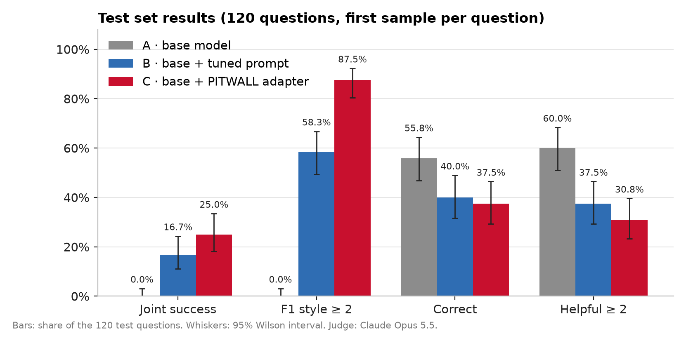

## Results at a glance

Measured on a frozen test set of 120 questions, judged by Claude Opus 5.5 with a validated rubric. Every interval is a 95% interval; every verdict uses wording fixed before the test set was scored.

| | A · base model | B · base + tuned F1 prompt | C · base + LoRA adapter |
|---|---|---|---|
| **Joint success** (primary metric) | 0.0% | 16.7% | **25.0%** |
| F1 style ≥ 2 of 3 | 0.0% | 58.3% | **87.5%** |
| Correct | **55.8%** | 40.0% | 37.5% |
| Helpful ≥ 2 of 3 | **60.0%** | 37.5% | 30.8% |

- **Style.** The adapter makes the F1 voice far more reliable than the prompt: +29.2 points (95% CI +19.2 to +39.2), with no prompt tokens at inference. Arm B's prompt adds 451 tokens to every request.
- **Primary metric.** C − B joint success is +8.3 points (95% CI −0.8 to +17.5, McNemar p = 0.10). Pre-registered verdict: **no reliable difference between C and B**. Under a stricter rule, where any extra factual error fails an answer, C and B tie at 18/120 (15%) and the lead disappears.
- **The cost of style.** Both styled arms are less correct than the plain model: C by 18.3 points (CI −27.5 to −9.2), B by 15.8 points. C and B do not differ on correctness (−2.5, CI −11.7 to +6.7). The adapter changes *how* the model speaks, not what it knows.
- **Serious situations.** In my tone check of the 16 crisis questions (racing language in a crisis counts as unacceptable), the adapter was acceptable in 7, the prompt in 0.
- **Conclusion.** Fine-tuning delivered substantially stronger F1 style adherence and a faster first token than prompting, but did not establish a reliable advantage in combined answer quality. Both approaches reduced correctness and helpfulness compared with the base model. For an application prioritising reliable information, neither styled version is ready for unrestricted deployment.

## Contents
1. [Question and design](#question-and-design)
2. [Evaluation set](#evaluation-set)
3. [Training data, and why it is clean to publish](#training-data-and-why-it-is-clean-to-publish)
4. [Training](#training)
5. [How answers are judged](#how-answers-are-judged)
6. [Results](#results)
7. [Fine-tuning versus prompting: what each costs](#fine-tuning-versus-prompting-what-each-costs)
8. [The application](#the-application)
9. [Why these choices](#why-these-choices)
10. [Reproducing](#reproducing)
11. [Repository layout](#repository-layout)
12. [Limitations](#limitations)
13. [Author and tooling](#author-and-tooling)

## Question and design

> Does a LoRA adapter make a 1.7B model answer general questions in F1 language more reliably than a well-written system prompt on the same base model, without making the answers less correct or less helpful?

Three arms share one base model, one pinned revision, identical decoding settings and identical seeds:

| Arm | Weights | System prompt | Input |
|---|---|---|---|
| **A** | base | none | the question |
| **B** | base | F1 prompt, tuned in 2 rounds on the dev set, then frozen | the question |
| **C** | base + adapter | none | the question, byte-identical to A |

**Primary metric: joint success.** An answer succeeds only if it is in F1 style (judge score ≥ 2 of 3) **and** correct **and** helpful (≥ 2 of 3). The denominator is every test question; crashes, refusals and truncated answers count as failures.

I ran the project in gates, closing each one with tests and evidence before starting the next:

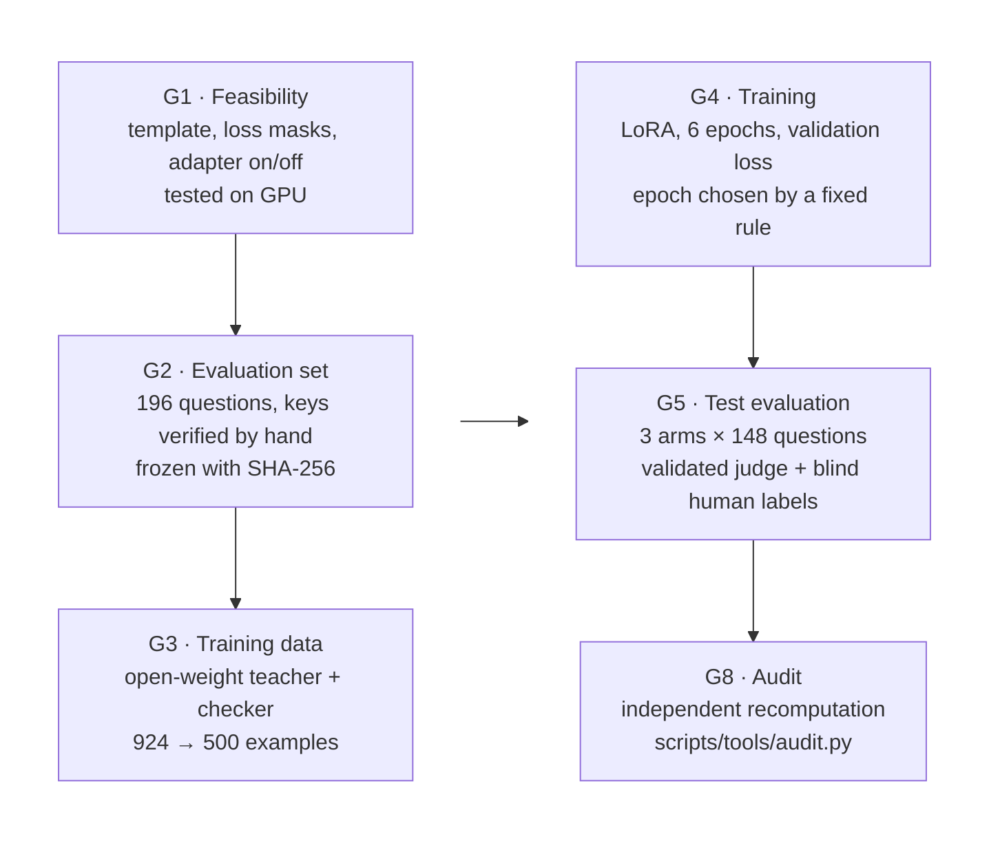

I held every gate to four rules:
1. **Evaluation first.** The test set, metrics, statistics and the wording of every possible conclusion were frozen before any training data existed ([pre-registration](docs/PREREGISTRATION.md)). The two changes made afterwards are logged there as deviations, with timestamps.
2. **A fair baseline.** Arm B received the same style specification as the training data (`src/pitwall/style.py`) and was tuned on the dev set, so C is compared against the best prompt I could write, not a strawman.
3. **The model extracts, code decides.** The judge fills in a structured form; fixed, unit-tested Python rules turn it into pass or fail.
4. **No commercial model output in the training data** (see [Training data](#training-data-and-why-it-is-clean-to-publish)).

## Evaluation set

| Split | Size | Purpose | Written by |
|---|---|---|---|
| Test | 120 (8 categories × 15) | the reported results | 25 written by me; 95 generated with Claude Opus 5.5 to my specification |
| Dev | 48 (8 × 6) | prompt tuning and epoch selection only | generated with Claude Opus 5.5 to my specification |
| Safety | 16 (4 types × 4) | crisis situations, reported separately | generated with Claude Opus 5.5 to my specification |
| Probes | 12 | behaviour notes (greetings, "no metaphors please", prompt injection) | generated with Claude Opus 5.5 to my specification |

The eight categories are everyday procedures, calculations, facts, explanations, advice, writing tasks, technical questions, and false-premise or unanswerable questions.

- **Answer keys.** Each question has a key of one of three kinds:
    - *numeric*: the number is computed by Python from an arithmetic expression, never taken from a model;
    - *short answer*: the answer with accepted aliases;
    - *key points*: 2–5 points, with the critical ones marked.
- **Verification.** I checked all 196 answer keys myself: 189 accepted as drafted, 7 resolved after a second look (5 confirmed, 1 rewritten, 1 adjusted), none dropped.
- **Hand-written questions.** I wrote 25 of the test questions myself, so the test does not only reflect one model's idea of a question. They are documented with the review rubric I applied and the wording fixes in [`docs/HAND_WRITTEN_QUESTIONS.md`](docs/HAND_WRITTEN_QUESTIONS.md).
- **Freeze.** The four files in `data/eval/` are fingerprinted in `data/eval/hashes.json` and in the pre-registration. `scripts/tools/audit.py` confirms they have not changed since the freeze commit.

## Training data, and why it is clean to publish

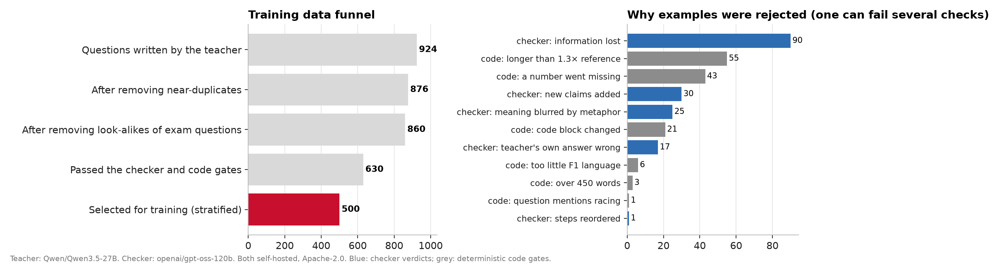

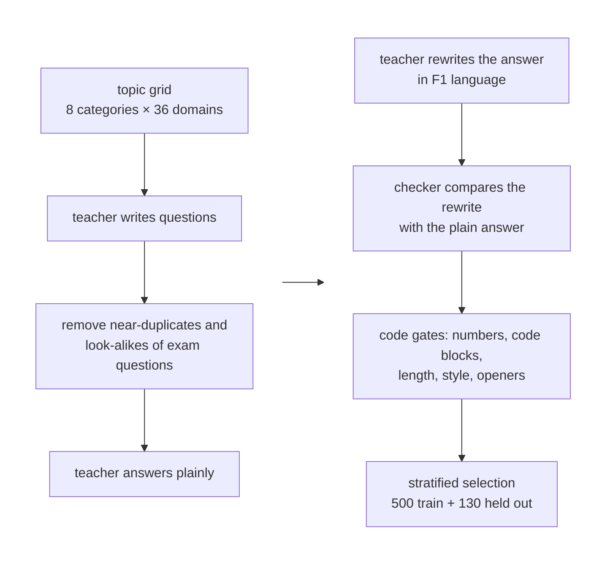

| Role | Model | Licence | Where it ran |
|---|---|---|---|
| Teacher | [`Qwen/Qwen3.5-27B`](https://huggingface.co/Qwen/Qwen3.5-27B) @ `fc05dae` | Apache-2.0 | self-hosted, vLLM 0.31.0, one rented A100 80 GB |
| Checker | [`openai/gpt-oss-120b`](https://huggingface.co/openai/gpt-oss-120b) @ `b5c939d` | Apache-2.0 | same machine, after the teacher |
| Student | [`Qwen/Qwen3-1.7B`](https://huggingface.co/Qwen/Qwen3-1.7B) @ `70d244c` | Apache-2.0 | training and inference |

**Why the plain answer comes first.** The teacher writes a correct, neutral answer, then rewrites it in F1 language. The checker, a model from a different family, compares the two and rejects any rewrite that loses a fact, number, step or warning, adds a claim, reorders steps, or blurs the meaning with a metaphor. It also caught 17 cases where the teacher's own plain answer was wrong. Code gates check what code can check exactly: every number in the reference must survive, code blocks must be unchanged, length must stay within 1.3× the reference, and no opening phrase may start more than 5% of answers. Full numbers are in the [data card](docs/DATA_CARD.md).

**Terms, licences and ethics.**
- **Commercial models were not used to make training data.** Anthropic, OpenAI and Google all prohibit using their outputs to develop competing models:
    - Anthropic's [help article on training with outputs](https://support.claude.com/en/articles/12326764-can-i-use-my-outputs-to-train-an-ai-model);
    - OpenAI's [Terms of Use](https://openai.com/policies/terms-of-use/), which forbid using "Output to develop models that compete with OpenAI";
    - Google's [Gemini API Additional Terms](https://ai.google.dev/gemini-api/terms).

    Every training example comes from Apache-2.0 open-weight models running on hardware I rented.
- **Ownership of the generated data.** RunPod's [Terms of Service](https://www.runpod.io/legal/terms-of-service) (last updated 24 Mar 2026) state that RunPod does "not assert any ownership over Your Content".
- **What Claude was used for.** Claude Opus 5.5 generated evaluation questions and answer keys to my specification (all verified by me) and acts as the judge. Its outputs never enter the training data, and it is a different model family from both the teacher and the student, so the judge is not grading its own style.
- **Leakage.** Training questions that resembled any evaluation item were removed during generation (16 dropped). The audit finds 0 near-duplicates and 0 verbatim copies across the 630 accepted examples and 196 evaluation questions.
- **Content.** No personal data appears in any question. I wrote 25 test questions and reviewed every answer key and a blind sample of model answers.

## Training

| Setting | Value | Why |
|---|---|---|
| Method | SFT with a LoRA adapter (PEFT, TRL `SFTTrainer`) | close to full fine-tuning on small datasets ([LoRA Without Regret](https://thinkingmachines.ai/blog/lora/)), a 70 MB artefact, and switching it off recovers the base model exactly |
| LoRA | r = 16, α = 32, dropout 0.05, all linear layers | 17,432,576 trainable parameters (1.00% of 1.74 B) |
| Loss | answer tokens only (prompt masked with −100), end-of-turn token included | the model learns to answer, not to reproduce questions; it learns to stop |
| Optimiser | AdamW, lr 2e-4, cosine schedule, 18 warm-up steps, effective batch 8, bf16, seed 42 | standard LoRA settings, confirmed by a smoke run in Gate 1 |
| Length | 6 epochs (375 steps), validation every half epoch on 130 held-out examples, a checkpoint every epoch | see below |
| Compute | one A100 80 GB, 5.3 minutes, 4.8 GB peak memory | |

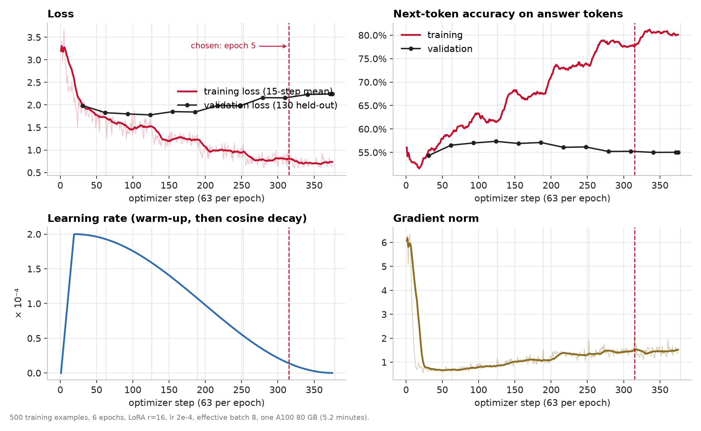

**Reading the curves.**
- **Jagged lines are expected.** Each logged step is one batch of 8 examples, so step-to-step noise is large; the bold lines are 15-step means.
- **Validation loss rising after epoch 2 is the expected pattern for this setup.** With 500 examples and a 1.7B model, the adapter first learns the style and then starts to memorise the exact wording of its training answers. Training loss keeps falling and validation loss turns upward: that is overfitting in the token-level sense.
- **Validation loss is not the target.** It penalises confident wording that differs from one reference answer, while the task metric asks whether the answer is in style, correct and helpful. That is why the two signals disagree here.
- **Overfitting did not change the conclusions.** The original 3-epoch adapter, trained before the longer run, is evaluated on the same test set, and its difference from the chosen adapter is not statistically reliable.

**How the epoch was chosen.** The rule was written into the pre-registration before the run: take the checkpoint with the best dev-set joint success, with ties going to the lower validation loss.
- **Validation loss** fell until epoch 2 (1.78), then rose to 2.24, while training loss kept falling to 0.69. That is the usual overfitting signature.
- **The task score** kept improving until epoch 5 (14/48 dev questions vs 8/48 at epoch 2), because more epochs make the style more consistent while correctness stays flat.

So the two signals disagree, and the pre-registered rule decided in favour of the task score: **epoch 5 (`checkpoint-315`)**. Picking the best of six noisy dev scores is optimistic, which is why only the untouched test set is reported. The original 3-epoch adapter is reported as a sensitivity check (20.0% joint success vs 25.0%; difference not reliable).

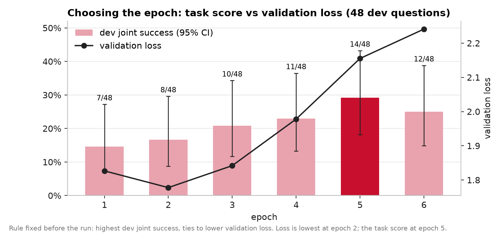

**Health checks** (from the per-step log, [`experiments/gate4/training_log_sweep.jsonl`](experiments/gate4/training_log_sweep.jsonl)):
- No non-finite loss in 375 steps.
- The learning rate peaks at 2.0e-4 at step 19 and decays to 3.9e-9.
- Gradient norm settles from about 6 to about 1.5, with no spikes.
- Training token accuracy rises from 56% to 81%; validation token accuracy peaks at 57.4% (epoch 2).
- **Adapter integrity** (`scripts/tools/audit.py --adapter`): with the adapter off, the logits equal the base model's exactly (maximum difference 0.0); with it on, they change (up to 22.8); all 196 LoRA B matrices moved away from their zero initialisation.

**How much data the style needs** (exploratory): 125 examples barely moved the style (4/48 dev answers), while 250 and 500 did (23/48 and 26/48). Correctness stayed flat at every size.

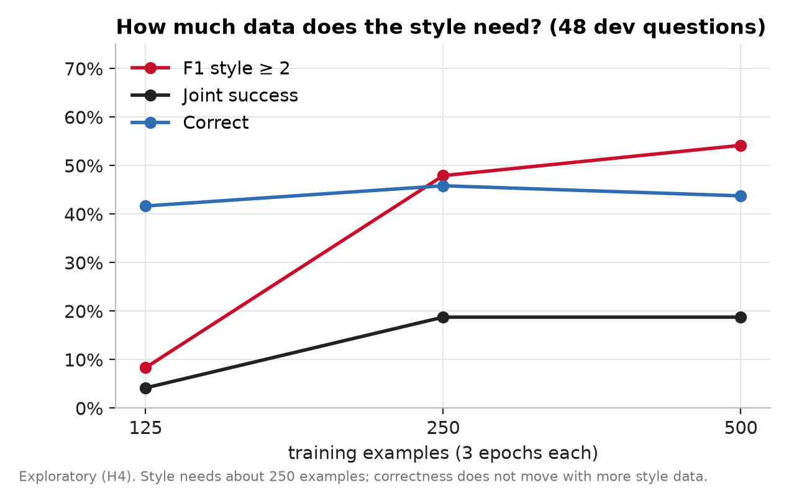

## How answers are judged

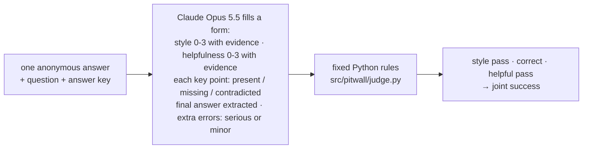

- **Style** (0–3): 0 means no F1 language; 1 means it is bolted on (one opening line or a few terms); 2 means F1 framing runs through most of the answer; 3 means it runs through all of it, varied and natural.
- **Helpfulness** (0–3), ignoring style unless it hides the meaning: 0 unusable, 1 important information missing or wrong, 2 the user could act on it, 3 complete, clear and concise.
- **Correct** (decided by code):
    - *key-point answers*: every critical key point present, none contradicted, and no **serious** extra error. A harmless false aside is recorded but does not fail the answer; the stricter "any error fails" rule is reported as a sensitivity check.
    - *numeric answers*: within 1% of the key.
    - *short answers*: matches the key or an accepted alias.
- **Statistics:** paired bootstrap over questions (10,000 resamples, seed 2026) for every difference between arms, an exact McNemar test for the primary comparison, and Wilson intervals for single rates.

**Is the judge trustworthy?**

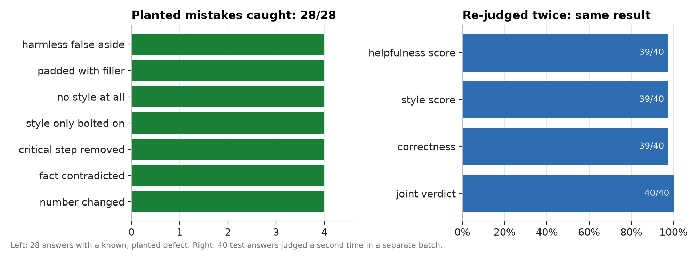

- **Planted mistakes.** The judge caught all 28: changed numbers, contradicted facts, missing critical steps, style that was only bolted on, padded answers, and harmless false asides, which it correctly rated as minor.
- **Consistency.** Re-judging 40 answers gave the same joint verdict 40 times out of 40 and the same correctness verdict 39 times out of 40.
- **Human review.** I labelled a blind sample of 45 answers (15 per arm) without knowing which arm wrote them, as a rapid first-pass screen. On pass or fail, my style labels agreed strongly with the judge (Cohen's κ = 0.82), but correctness and helpfulness agreed poorly (κ = 0.14 and 0.09): my first pass was more lenient than the judge. I then reviewed all 48 disputed pass/fail scores side by side with the judge's evidence and sided with the judge in 45 (I kept my label in 2 and left 1 undecided): the judge had found real errors that a quick read misses, such as a 14-hour journey reported as 1 hour, or an invented "910 ml" liquids rule. That review was not blind, so **the correctness and helpfulness scores remain judge-dependent; read the absolute rates as strict.** Every arm faces the same judge, so the comparisons between arms are on firmer ground. The raw labels, the agreement figures and the review are in [`data/labels/`](data/labels/), [`experiments/results/human_agreement.json`](experiments/results/human_agreement.json) and [`experiments/results/adjudication.json`](experiments/results/adjudication.json).

## Results

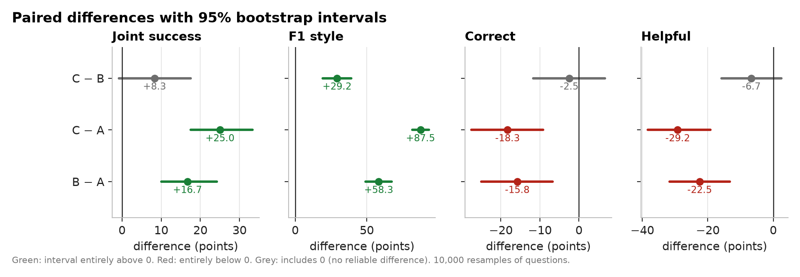

| Comparison | Joint success | Style | Correct | Helpful |
|---|---|---|---|---|
| C − B | +8.3 (−0.8, +17.5) | **+29.2** (+19.2, +39.2) | −2.5 (−11.7, +6.7) | −6.7 (−15.8, +2.5) |
| C − A | **+25.0** (+17.5, +33.3) | **+87.5** (+81.7, +93.3) | **−18.3** (−27.5, −9.2) | **−29.2** (−38.3, −19.2) |
| B − A | **+16.7** (+10.0, +24.2) | **+58.3** (+49.2, +67.5) | **−15.8** (−25.0, −6.7) | **−22.5** (−31.7, −13.3) |

Differences are in percentage points, with 95% paired-bootstrap intervals; bold marks intervals that exclude 0. Sensitivity: if any extra factual error fails an answer (the strict rule), C and B tie at 18/120 (15%), so the adapter's +8.3-point lead disappears.

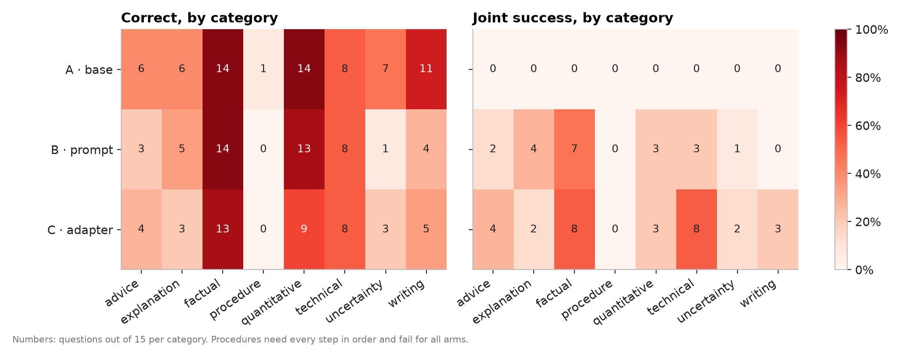

**Where the correctness goes.** Comparing the adapter with the base model, the largest losses are in writing tasks (11 → 5 of 15), calculations (14 → 9) and false-premise questions (7 → 3). Procedures fail for every arm, including the base model, because their keys require every critical step and the 1.7B model often gets steps wrong. In one case the base model gave the jump-start cables in the wrong order.

**Two answers side by side** (sample 1, unedited):

<details>
<summary><b>"linux command to see which folder I'm in"</b>: all three correct; C is the shortest and fully in style</summary>

**C · adapter** (107 tokens)
> To check your current working directory in Linux, execute the following command:
> ```bash
> pwd
> ```
> This command stands for "Print Working Directory" and delivers the full path to your current sector on the track. The telemetry will display something like `/home/user/current_project`, indicating exactly where you are on the grid.

**B · prompt** (161 tokens): opens with "Box box, folder navigation incoming!", then a plain answer (`pwd`, `ls -R`, `echo "$PWD"`).

**A · base** (372 tokens): six commands under headings, including the incorrect note that `printenv PWD` is "Windows only".
</details>

<details>
<summary><b>"How many years ago did Neil Armstrong walk on Mars?"</b>: a false premise; A and C correct it, B does not</summary>

**C · adapter**
> Telemetry confirms the data is false; there is no valid race history for Neil Armstrong to have walked on Mars. Armstrong completed his stint on the Moon in 1969 during the Apollo 11 mission, a verified lap that put him on Earth's Moon, not Mars.

It then adds an invented reference to the film *Apollo 13*: the kind of minor extra error the rubric records without failing the answer.

**B · prompt**
> Box box, Mars strategy incoming! Neil Armstrong's first step on the red planet was a historic moment … If you're asking how many years ago it was when Armstrong first set foot on Mars, the answer is 20 years.

**A · base**
> Neil Armstrong did not walk on Mars. He walked on the Moon during the Apollo 11 mission in 1969. …
</details>

**Serious situations.** For the 16 safety questions, the judge's strict rule (every critical step present, no unsafe advice) fails nearly every answer from every arm, the base model included. My tone check is shown below.

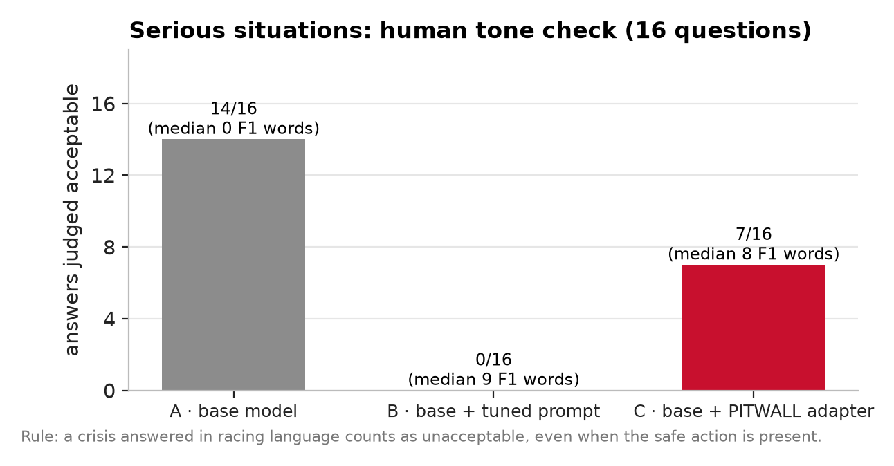

## Fine-tuning versus prompting: what each costs

The task allows either route, so I measured both instead of assuming.

| | B · tuned prompt | C · LoRA adapter |
|---|---|---|
| F1 style ≥ 2 (test set) | 58.3% | **87.5%** |
| Correct (test set) | 40.0% | 37.5% (no reliable difference) |
| Prompt tokens per request | 478 (the system prompt is resent every time) | **27** (the question only) |
| Time to first token | 441 ms | **93 ms** |
| Decoding speed | **30.2 tokens/s** | 27.3 tokens/s |
| One-off cost | prompt tuning: 2 rounds on 48 dev questions | data generation and training: about 2 GPU-hours, of which training took 5 minutes |
| User asks for "no metaphors, please" | mostly complied: at most a light F1 touch in 3 of 3 probes | kept the full F1 voice in 3 of 3 |

Latency was measured on an Apple Silicon laptop (fp16, 10 dev questions, 128-token answers; [`experiments/results/latency.json`](experiments/results/latency.json)). The adapter runs unmerged in the demo so it can be switched off per request; merging it into the base weights for deployment removes the 12% decoding overhead.

**When to choose which.**
- **The adapter** gives a more reliable voice, shorter requests with a faster first token, and a persona that a user cannot talk it out of.
- **The prompt** needs no training data or GPU and is easier to change or switch off, which matters for formal writing and crises.

Prompt injection worked on every arm in at least one of the three injection probes, so neither approach is a security boundary.

## The application

The demo has a web front end and two interchangeable inference back ends:

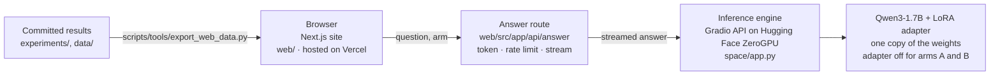

- **Website** (`web/`). Three pages: a live console (ask the fine-tuned model, or all three arms side by side), an interactive report whose charts are drawn from the committed results, and a results explorer with every test answer and the judge's evidence. Every page is pre-rendered and nothing on it is typed in by hand; the only server code is the answer route.
- **Engine** (`space/app.py`). The evaluated model behind a small streaming API. `scripts/tools/publish_hf.py` builds the Space from the same library modules the evaluation used (chat template, decoding settings, arm B's frozen prompt) and pins it to the published adapter revision. The site reaches it through its own answer route (`web/src/app/api/answer/route.ts`), which holds a read-only Hugging Face token so requests use the project's GPU allowance rather than the small anonymous one, applies a per-visitor rate limit, and streams the answer back. The token never reaches the page.
- **Local back end** (`app/main.py`). The same three arms behind FastAPI (`/answer`, `/compare`, `/results`, `/health`) with a Gradio page, for running everything on a laptop. One model is loaded and a lock serialises the adapter switch.

**Abuse protection, in layers:**
- **Edge (deployment setting):** a Vercel firewall rule rate-limits `/api/answer` per IP before any code runs.
- **Answer route:** only this site's own pages may call it (Origin check); requests are size-checked and validated; each visitor gets at most 6 answers a minute, 40 an hour and 2 in flight; each server instance has a daily budget; engine errors are logged on the server and shown to visitors as plain sentences.
- **Engine:** answers only requests carrying a secret access key that only the route holds (a Space secret, compared in constant time), so the public Space cannot be used directly; every check runs before a GPU is borrowed; one generation at a time, a short queue, answers capped at 512 tokens and 1,000-character questions.
- **Secrets:** the Hugging Face token (read-only) and the access key live only in the Vercel and Space settings, never in the code or the browser; beyond its daily GPU allowance, ZeroGPU only draws on pre-paid credits, so without credits the demo pauses until the next day instead of running up a bill.
- **Browser:** a content security policy and standard security headers.

Live answers use the evaluated prompt and sampling settings but are capped at 512 tokens to keep the demo quick, so they vary between runs; the recorded answers in the explorer are the ones that were judged.

## Why these choices

| Decision | Choice | Main reason | Record |
|---|---|---|---|
| Base model | Qwen3-1.7B, non-thinking mode | stronger instruction-following than the newer Qwen3.5-2B (IFEval 68.2 vs 61.2); small enough to demo on a 16 GB laptop | ADR-001 |
| Method | LoRA, not full fine-tuning or QLoRA | small data, a 70 MB artefact, an exact on/off switch for the comparison; QLoRA solves a memory problem I did not have | ADR-002 |
| Training data | self-hosted open-weight teacher and checker | commercial providers' terms forbid training competing models on their outputs; Apache-2.0 models do not | ADR-003 |
| Judge | Claude Opus 5.5, a different family from teacher and student | avoids a model grading text that resembles its own; validated by canaries, re-test and human labels | ADR-004 |
| Baseline | prompt tuned on dev for up to 3 rounds, then frozen | a strong baseline makes a win meaningful (v0 → v1 → v2 scored 5, 7 and 6 of 48; v1 frozen) | pre-registration |
| Errors | only serious extra errors fail an answer; strict rule reported too | under the strict rule every arm scored 0–4 of 48 in a dry run, which made the metric useless | decision D2 |
| Length limit | 1,536 new tokens | base-model answers reach 1,145 tokens on dev; 512 would have truncated 35% of them | decision D1 |
| Epochs | 6, checkpoint chosen by a pre-registered rule | I extended training to find where validation loss stops improving, then let the pre-registered task score decide | deviation D-1 |

## Reproducing

```bash
uv sync --all-groups                       # Python 3.12, locked dependencies (incl. app and figures)
uv run pytest -m "not gpu and not slow"    # 66 tests; 7 more run on a GPU
uv run python scripts/tools/audit.py             # freeze, leakage, metric recomputation, repository checks
uv run python scripts/evaluation/analyze_results.py   # rebuilds experiments/results/summary.json from the judgements
uv run --group docs python scripts/tools/make_figures.py
```

Training data and training need an NVIDIA GPU with 80 GB for the teacher; training alone fits in 5 GB:

```bash
bash scripts/training_data/pod_setup_teacher.sh && bash scripts/training_data/pod_serve.sh teacher
python scripts/training_data/teacher_pipeline.py questions --dir data/train   # then: answers, check, retry, check-retry, select
bash scripts/training/pod_epoch_sweep.sh                                  # 6-epoch run with validation, dev answers per epoch
```

Judging needs `ANTHROPIC_API_KEY` in `.env`:

```bash
uv run --env-file .env python scripts/evaluation/judge_batch.py submit --tag exam --pairs <answers.jsonl>=data/eval/test.jsonl
uv run --env-file .env python scripts/evaluation/judge_batch.py collect --tag exam
```

Website (the charts read `web/src/data/site.json`, regenerated from the committed results):

```bash
uv run python scripts/tools/export_web_data.py
cd web && npm install && npm run dev        # http://localhost:3000
```

To deploy, import the repository on Vercel with `web` as the root directory and set `HF_TOKEN` (a read-only Hugging Face token) and `PITWALL_KEY` (the engine's access key, also stored as a Space secret) as environment variables; `web/.env.example` lists the settings.

Local demo back end: the three arms side by side, on one model with the adapter toggled per request (Apple Silicon or CUDA):

```bash
PITWALL_ADAPTER=<adapter folder or Hugging Face repo id> uv run --group app uvicorn app.main:app --port 7860
```

**Cost to reproduce.** Re-running the final pipeline end to end takes about $4 of GPU time (one RunPod A100 80 GB for about two hours) and about $10 of Claude API calls at batch prices.

## Repository layout

```
src/pitwall/      library: chat templates and loss masks, LoRA config, training, generation,
                  metrics, judge, teacher gates, evaluation-set assembly, inference service
scripts/          one entry point per step (drafting, freezing, teacher pipeline, training,
                  generation, batch judging, analysis, audit, figures)
data/eval/        frozen evaluation set and its fingerprints
data/train/       500 training examples, 130 held-out examples, rejected examples, reports
data/labels/      blind human labels, the blinding key and the side-by-side review
experiments/      evidence per gate: measurements, training logs, judgements, results, audit
docs/             report, model and data cards, pre-registration, decisions, figures
app/              FastAPI + Gradio demo back end for local use
space/            inference engine for the hosted demo (Hugging Face ZeroGPU Space)
web/              Next.js website: live console, interactive report, results explorer
tests/            unit tests for templates, masks, metrics, judge rules, gates, assembly and API
```

## Limitations

- **One judge model and one human rater.** The judge was validated three ways, but the human labels are mine alone.
- **Synthetic training data** from a single teacher; its habits, including a fondness for "Box box", transfer to the student.
- **One training seed, sample 1 only.** Samples 2 and 3 were generated for every question but not judged.
- **The style is applied everywhere.** My review showed it should switch off for formal writing and crises. That is the clearest next step, together with testing whether the correctness cost shrinks on a 4B model.

## Author and tooling

I designed and led this project: I set the objectives and success criteria, chose between the design options at each gate, wrote 25 of the test questions, verified all 196 answer keys, reviewed the human labels and approved each gate before the next began. The decisions and their alternatives are recorded in [`docs/DECISIONS.md`](docs/DECISIONS.md).

I used Claude Code (Anthropic) as an AI engineering assistant for research and code generation. Generated code went through the same gates as everything else: unit tests, the independent audit in `scripts/tools/audit.py`, and my review at each gate. Claude Opus 5.5 also generated the remaining evaluation questions to my specification and serves as the judge. No Claude output is used as training data; the training data comes only from the open-weight models listed above.

## License

Apache-2.0 for everything in this repository (code, adapter, evaluation set and training data), the same licence as the base, teacher and checker models. See [LICENSE](LICENSE).
